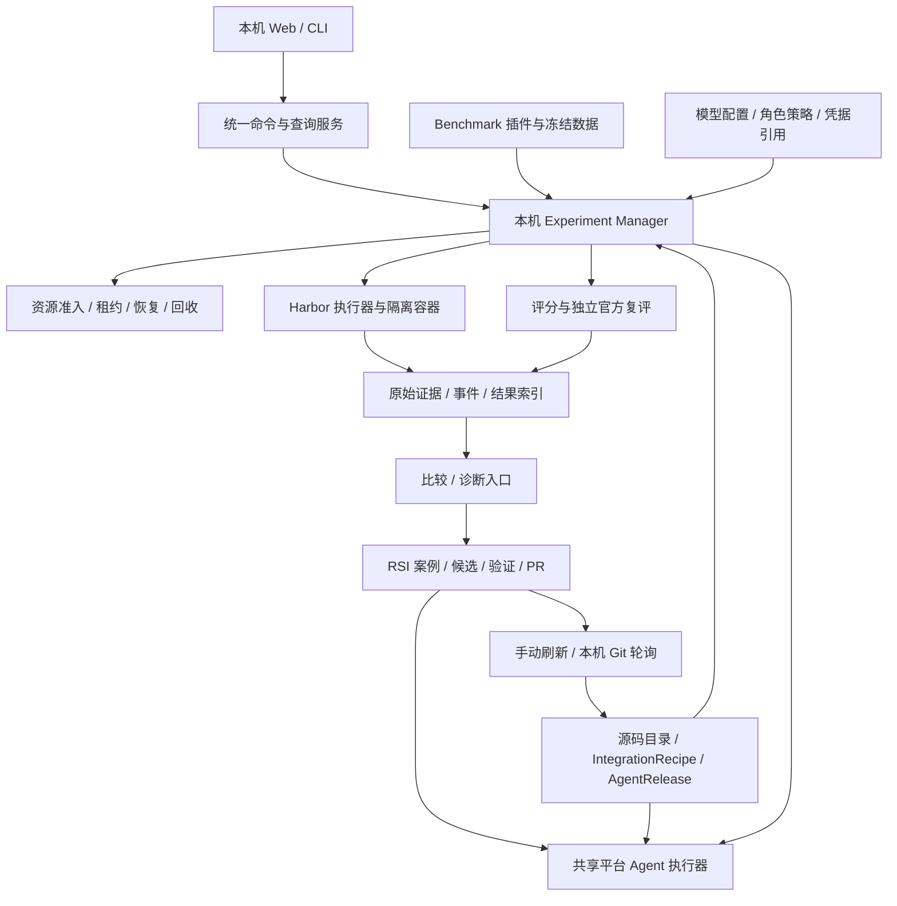

# 本地单用户 Agent Harness 测评与 RSI 平台架构设计

日期：2026-10-26。状态：目标架构与实施依据，尚未实现的能力均按规划描述。

源码评估基线：`328baf8`（`fix: normalize set fields when resuming frozen experiments`）。本轮仅编写文档，不修改运行代码，不执行模型实验，不部署服务器。

配套文档：[分阶段实施计划](../plans/2026-10-26-local-single-user-platform.md)。本设计统合前期 Agent 接入、统一模型、公平比较、GitHub 驱动 RSI 和[实验并发与守护讨论](https://chatgpt.com/s/cx_6ace589f51a081918a984e86d469f40a)。既有专题文档继续描述当前实现；本设计描述后续演进方向，不应作为已发布功能清单。

## 1. 定位与结论

项目定位为：**开发者部署在自己机器上的 Agent Harness 实验工作台**。用户选择自己的 Agent、已支持的开源 Agent、benchmark 和统一模型，得到可追溯的比较结果，并将失败证据用于诊断、改进和回归验证。

“本地”包括个人电脑、工作站和用户独占的私有服务器；“单用户”不等于一次只能运行一个实验。系统仍需管理多个 Agent、多个实验、多个平台 Agent 和共享的 Docker、磁盘、CPU、内存、模型额度。数据与密钥由用户控制，平台进程关闭、机器重启和网络中断都是正常生命周期事件。

当前架构可以继续演进，不需要推倒 Harbor、原生 Agent 执行或现有证据体系。短板主要在平台编排层：接入标准尚偏代码级、评测版本与源码版本关系不够通用、实验/复评/RSI 的生命周期分散、资源所有权和最终评分视图尚未统一。继续把功能堆进 `console.py` 或给每种 Agent 单独写一条 RSI 流程，会放大维护成本。

采用**模块化单体 + 本机管理进程 + 隔离执行进程/容器 + SQLite/文件证据**。模块是 Python 内部边界，不为每个模块部署微服务。

| 方案 | 优点 | 代价 | 决策 |
| --- | --- | --- | --- |
| 保持现有脚本与 Web 各自编排 | 短期改动最少 | 接入、恢复、资源和 RSI 规则继续分叉 | 只用于过渡兼容 |
| 模块化单体、本机统一编排 | 复用现有实现，安装简单，能统一状态与证据 | 需要分阶段迁移调度入口 | 采用 |
| 多租户服务、消息集群、分布式 Worker | 适合团队托管和多机集群 | 运维、认证、数据隔离成本与定位不符 | 当前排除 |

首期不建设组织/租户、RBAC、计费、多用户任务隔离、公网控制台、Kubernetes 或多机调度。保持执行器边界，不以“以后可能 SaaS 化”为由提前实现这些能力。

## 2. 需求与验收索引

| ID | 需求 | 完成的可观察结果 | 阶段 |
| --- | --- | --- | --- |
| R01 | 本地单用户部署 | 干净 Linux 环境按文档完成检查、无模型控制实验和结果查看；停止 Web 不丢执行权 | P0–P1 |
| R02 | 规范接入自己的 Agent | CLI recipe 或 Python 扩展通过同一接入检查；不要求修改核心分发 | P2 |
| R03 | 内置开源基线 | DSH、BKCrab、OpenCode、Hermes 有独立版本、profile、安装与 smoke 状态 | P2 |
| R04 | benchmark 目录与扩展 | SWE、控制任务采用同一生命周期接口；自定义 Harbor 任务能注册、冻结和评分 | P2 |
| R05 | 统一模型与公平性 | 所有被测 Agent 的主循环/子 Agent/压缩/回退模型策略可核验；不一致明确阻断或降级结论 | P2 |
| R06 | 清晰结果与诊断 | 执行、评分、证据、资源独立展示；逐题比较可跳转原始证据 | P1、P3 |
| R07 | GitHub 驱动评测版本 | 每轮固定 SHA，外部 push 与 RSI merge 同样生成候选版本；运行中不替换 | P4 |
| R08 | 可重复接入与 patch 演进 | 接入 recipe/patch 独立版本化；冲突显式失败；改进 PR 不混入平台胶水 | P2、P4 |
| R09 | RSI 改进闭环 | 证据→诊断→候选→分层验证→PR→实际合并 SHA→重新接入与评测 | P3–P4 |
| R10 | 有界资源与批处理 | 20/80/500 题无需提前构建全部镜像；复评积压、磁盘不足会产生背压 | P1 |
| R11 | 成熟 Agent 守护 | 可复用完整 Agent 执行器，多轮调查与操作有记录；确定性代码负责所有权和终止 | P3 |
| R12 | 升级、恢复和迁移 | 原始冻结证据不改写，迁移可回滚，恢复不重复调用模型或接受过期 Worker 结果 | P0–P4 |

## 3. 最新源码能力盘点

以下是源码可确认的能力，不代表本轮重新跑过相应验收。工作区另有 `resources/live_model.py` 修改和 `tests/test_relay_roles.py` 未提交文件；其中角色隔离方向不能视为本基线已发布能力。本方案不修改这些文件。

| 当前模块 | 已有价值 | 保留 / 重构 / 新增 |
| --- | --- | --- |
| `agents/native.py`、`bkcrab.py`、`dsh.py` | Harbor installed-agent，保留原生循环，版本/包/profile 留痕 | 保留执行与原始行为；新增统一 recipe、能力认证和通用适配入口 |
| `dsh_bundle.py`、`runtime_bundle.py`、`integrations/bkcrab-eval.patch` | 固定依赖、构建包、BKCrab eval 入口 | 保留构建证据；重构为 Agent 专属 recipe，移除通用流程对某一个 Agent 的隐式依赖 |
| `config.py`、`freezing.py`、`provenance.py`、`manifests.py` | 严格配置、输入冻结、哈希与来源 | 保留；新增 schema version、Release/Plan 标识；将具体 Agent/benchmark 规则移入插件或 profile |
| `run.py` | 输出锁、运行/恢复、哈希检查，明确的 `workbench_repair` 审计 | 保留；由统一管理进程调用；继续区分基础设施修复与实验条件改变 |
| `console.py`、`web.py`、`cli.py` | Web/CLI、历史索引、现有队列和 RSI action | 保留页面/API 入口；重构提交、状态与调度，Web 不再拥有执行生命周期 |
| `batching.py`、`image_lifecycle.py` | 分批、镜像租约与清理协调 | 保留有用机制；从保守全局等待改为可核验的资源消费者关系和容量准入 |
| `regrading.py`、`benchmarks/swe.py` | 独立官方复评、持久队列、进度、同 Unix 用户的全局并发限制、瞬态失败重试 | 保留评分实现与防重复证据；统一 Job/资源预算，正式比较接入官方评分状态 |
| `model_pool.py`、`resources/live_model.py` | 模型配置、凭据引用、relay 和使用记录 | 保留；新增版本化角色策略、协议兼容检查与被测模型实际使用证明 |
| `search.py`、`resources/search_review.py` | Exa relay，DSH 与 BKCrab 搜索审查、固定 JEV 决策证据 | 保留；将搜索策略纳入实验指纹和覆盖声明 |
| `comparison.py`、`report.py`、`trace_view.py` | 条件比较、报告、原始轨迹展示 | 保留；统一 Attempt/GradeRun 读模型、分母、失败分类与证据链接 |
| `guardian/*` | observe/assist、多轮模型驱动、探测、留证和确定性进程监管 | 保留执行安全边界；新增通用成熟 Agent 执行器，避免以一次 LLM 请求冒充完整守护能力 |
| `rsi/*` | 冻结案例、候选、Git 工作区、原生构建、针对性回归、发布检查 | 保留证据/语言/PR 规则；泛化构建和验证，新增仓库跟踪、合并观察与版本准入 |

应避免误读的现状：

- 官方复评已经有队列与并发控制；缺口不是“从零加队列”，而是与总资源预算、评分展示和恢复合一。当前比较页面主要读取 Harbor 内置结果，不能据此宣称官方复评已统一成为所有比较的主结果。
- 当前原生 RSI 内置构建/回归偏 BKCrab 与 DSH；针对性回归可验证具体假设，不自动等于整套 benchmark 提升。已有 publication 验证不是空白，但尚无通用 GitHub 合并后版本循环。
- 当前 Web 生命周期与执行进程仍有关联；已有 CLI 恢复与审计能力，不等于完整的 Web 暂停/取消/恢复控制。
- 当前 Guardian 任务支持面有限：多步骤任务、独立 verifier 等需要显式适配，不以“Harbor 支持”推导平台全链路已支持。
- Exa 与 DSH 搜索代理审查不覆盖所有浏览器、shell、直连搜索、Brave/SearxNG 或 webfetch；它也不是容器网络隔离边界。JEV 不可用与判定拒绝必须分开，固定版本和阈值不能解释为已经校准的普适指标。
- 最近清理逻辑已经识别 Compose 实际镜像并保护其他引用；仍需精化跨阶段消费者，不能退回通用 `docker prune`。

## 4. 模块与职责



| 边界 | 负责 | 不负责 |
| --- | --- | --- |
| Agent catalog / integration | 来源、版本、recipe、构建、接入检查 | benchmark 判分、自动修改运行中的 Release |
| Benchmark registry | 数据版本、任务选择、准备、结果提取、评分、清理依赖 | Agent 的提示词、规划循环和工具内部实现 |
| Experiment Manager | 冻结计划、作业图、状态转换、调度和恢复 | 在调度代码内实现 Agent 或 SWE 评分规则 |
| Resource coordinator | 本机共享容量、租约、磁盘预算、回收与限流 | 替用户清理未归属本平台的 Docker/进程 |
| Model policy | 被测模型约束、角色路由、凭据、调用证据、预算 | 假设填写相同 model id 就证明服务端权重相同 |
| Evidence / measurement | 原始证据索引、评分来源、比较条件和结论等级 | 用缺失数据补零、事后挑选好看的样本 |
| Platform Agent executor | 启动成熟 Agent、多轮工具执行、结构化输出与审计 | 自己决定超预算、扩大授权或修改评分规则 |
| RSI | 从案例到改进候选、分层验证、PR 和反馈关联 | 把接入胶水作为默认产品改进、自动合并 PR |

## 5. 本地部署、存储与安全边界

### 5.1 运行形态

安装基线先支持 Linux x86_64 + Docker。WSL2 是后续经过验收后开放的入口；当前代码涉及 `fcntl`、`/proc`、Linux 进程组和 Docker，不宣称支持 Windows 原生执行。

提供一个 `doctor` 检查入口和一个启动入口。doctor 区分必需组件与当前选择的 Agent/benchmark 可选组件；仅使用 DSH 时不要求 BKCrab 的 Go 构建链。预检报告磁盘余量、Docker 权限、CPU/内存、端口、模型协议连通性和缺失依赖，默认连通性检查不进行付费生成。

管理进程独立于 Web，可以使用用户级 service 或受控后台进程启动，选择一种推荐安装方式，不同时维护多套默认编排。Web 默认 `127.0.0.1`；私网访问继续显式配置可信地址和同源检查，不将现有无登录控制台暴露公网。平台主程序不强制容器化；被测 Agent 与 benchmark 的执行隔离由 Docker 负责。BKCrab 的实际服务器部署仍遵守项目 Docker 部署约定。

### 5.2 数据布局（目标，不自动迁移）

```text
<workspace>/
  workspace.json              # schema、workspace_id、配置与根路径
  state.sqlite                # 操作状态、作业、租约、索引与迁移版本
  catalogs/                   # 仓库与 recipe 定义、benchmark 注册
  sources/                    # 源码缓存；不执行未准入源码
  releases/<digest>/          # 不可变 Release manifest 与构建引用
  experiments/<id>/           # 冻结计划、原始日志、轨迹、评分、事件
  rsi/<case-id>/              # 冻结案例、候选、诊断、验证、发布证据
  cache/                     # 可重建下载与构建缓存
  retained/                  # 有期限的异常工作区副本
```

SQLite 负责可变操作状态与查询索引；不可变 manifest、原始事件和产物是实验事实依据。索引可以重建，原始缺失证据不能凭索引重建。大型日志不放进 SQLite。事务通过 outbox/幂等 key 连接外部操作，状态变更与事件链接保持可核对。

凭据使用 secret reference；优先系统密钥存储或环境变量，文件回退须限制当前用户权限、位于 Git 忽略路径，不进入冻结配置、容器镜像和导出包。UI 可提交密钥配置但不回显明文；日志脱敏同时保留有权限读取的必要本地证据，分享导出默认脱敏。GitHub token 与模型 token 分开，不注入被测 Agent 容器。

同一个用户、同一个 Docker daemon 上的多个 checkout 默认共用一个协调入口，避免各自认为自己拥有全部机器资源。不同工作区记录独立，但容量与资源所有权协调范围是执行主机。首期不支持绕过协调器的多管理进程抢同一状态库。

GitHub URL 只是来源登记，不代表授权执行安装脚本、无限付费、推送代码或发 PR。用户在本地配置一次可持久化的范围策略；后续范围内操作自动进行，越界动作明确请求授权。未知仓库首次构建用受限容器执行，不把 Docker socket、宿主 home 和发布凭据交给它。

## 6. 核心领域对象与不可变边界

| 对象 | 最小内容与身份 | 可变部分 |
| --- | --- | --- |
| `SourceRevision` | repo URL、ref、解析后的 commit SHA、获取时间、来源事件 | 无；分支指针另存 |
| `IntegrationRecipe` | schema、来源、依赖锁、构建/启动命令、patch、模型映射、profile、证据映射、能力检查 | 修改产生新版本 |
| `AgentRelease` | source SHA + recipe digest + patch digest + 依赖/运行时/镜像 digest + profile + 构建产物 hash | 准入和推荐指针在外部维护 |
| `BenchmarkRevision` | dataset/version/split、任务内容与选择算法/seed、verifier/官方评分器版本、隐藏数据引用 | 无 |
| `ExperimentPlan` | Release 列表、BenchmarkRevision、任务/重复、ModelPolicy、资源/超时、评分/网络/assist 策略、workbench 版本 | 执行状态独立 |
| `Attempt` | experiment、agent release、task、repeat index、执行实例和原始证据引用 | 执行/证据状态 |
| `GradeRun` | attempt、评分器版本、输入产物 hash、执行次数、结果/日志 | 队列与评分状态；旧结果不覆盖 |
| `ResourceLease` | owner、类型、实际资源 ID、消费者、generation、heartbeat、TTL | 生命周期和消费者释放 |
| `Incident` | attempt、异常类型、证据引用、诊断与处置关联 | 处置进展 |
| `Candidate` | case、base SHA、candidate SHA、假设、改动、验证组、PR/merge 关联 | 验证与发布进展 |

Release digest 标识实际输入与构建产物，不承诺外部工具链天然可复现；同输入构建得到不同产物时保留不同身份和原因。模型 secret 不参与 digest，非秘密的 endpoint/model/参数/策略参与。上游不公开权重版本时记录可观察服务版本与时间，结论中说明限制。

禁止改写 frozen plan 来“更新到最新”。原有 `workbench_repair` 保留为窄例外：批准的基础设施修复需记录前后代码 hash、允许差异、原因与受影响 attempts；输入、模型、评分器、Agent 行为等测量条件变化必须新建计划。基础设施修复也需在比较时展示执行分段，不隐去潜在影响。

状态分四个轴，不能由一个 `completed` 推断全部成功：

- execution：queued / preparing / running / paused / interrupted / completed / cancelled / failed。
- scoring：not_requested / pending / running / complete / partial / failed。
- evidence：complete / partial / missing。
- resources：active / retained / reclaim_pending / reclaimed / cleanup_failed。

任务正常结束但未解出是测量结果；超时、调用失败、评分失败、缺少补丁和证据丢失是不同事件。清理失败可在后台修复，不篡改已经确认的题目得分。

## 7. Agent 接入：从声明到可信评测版本

### 7.1 两种入口、同一个标准

普通开发者提交 CLI recipe；需要复杂控制的开发者实现 Python Adapter。两者最终都通过统一协议进入 Harbor，不要求所有用户继承内部类。

recipe 包含 `schema_version`、repo/ref、runtime/build、entrypoint/args、工作目录与用户状态隔离、模型配置映射、环境变量白名单、网络需求、profile 差异、patch 列表、任务输入/结果输出、日志/usage/trace 映射、能力声明。命令使用 argv 数组，避免对用户输入拼接 shell 命令。密钥只填引用。

基础契约：平台提供任务说明、workspace、预算/截止时间、模型配置引用与输出目录；Agent 保持自己的原生循环；平台收集结束状态、结果产物、原始日志、可获取的调用/工具事件和 usage。Agent 不接触隐藏测试与标准答案，不自行选择评分器。

接入检查分层而非伪装成统一全能力：

| 级别 | 必须通过 | 允许结论 |
| --- | --- | --- |
| Runnable | 可构建/启动/停止、隔离目录、产物路径、超时与清理 | 能执行；不能自动声称公平或可深入诊断 |
| Comparable | 模型/子调用策略可核验、profile/网络差异声明、任务接口兼容 | 满足指定比较协议；不足处显式展示 |
| Diagnosable | 关键 trace/usage/工具证据可定位且与 attempt 关联 | 对覆盖范围内的机制做诊断 |

普通日志没有 token 或工具事件时标记缺失，不凭文本猜出精确成本。推荐原生 hook/事件导出，其次 wrapper/proxy，确有必要再 patch；每一项改造说明是否影响执行语义。

### 7.2 GitHub URL 的交互

用户输入仓库 URL 与 ref → 固定 SHA → 查找仓库内标准 recipe 或内置 recipe → 缺失时由 Integration Agent 生成候选 recipe → 隔离构建 → mock/协议/停止/证据检查 → 展示改造与能力 → 准入 Release。

首次接入允许少量补充：启动方式、特殊依赖、许可证/下载条件或无法自动推断的模型协议。产品承诺是“尽量自动生成可审查接入结果”，不是“任意仓库只填 URL 必然可跑”。失败停在有解释的阶段，可手工修改 recipe 后重试；不能在主机任意执行猜测的安装命令。

### 7.3 内置 Agent 与 profile

先把已有 DSH、BKCrab 包装成标准 recipe，再分别接入 OpenCode、Hermes。各自独立安装、锁定版本、验收、标注支持 OS/架构和模型协议。后两者是待验收集成，不因为出现在选择框就称为可用。

比较保留原生 planner、工具实现、压缩与子 Agent 策略，这些正是 harness 的变量。coding-isolated profile 明确无个人记忆、外部私有技能、聊天网关等；不把一个删掉关键组件的最小 SDK 冒称原版 Standard。不同 profile 单独显示和冻结。

## 8. 模型、外部工具与公平比较

模型池保存用户的 API URL、API key 引用、model id、协议、参数和上下文限制。选择模型形成不可变 `ModelPolicy` 快照，实验开始后修改模型池只影响新计划。

区分模型角色：

- `agent`：被测主 Agent、子 Agent、压缩、总结、重试及回退的全部模型调用；默认要求使用同一个用户选择的模型。某组件无法覆盖时准入检查失败，或明确创建非受控比较。
- `integration` / `guardian` / `diagnosis` / `improvement`：平台工作所用模型，可与被测模型不同，预算与成本独立，不计入被测 Agent 的自身消耗。
- `official_grading` / `user_simulator`：只有对应 benchmark 需要时启用，遵循该 benchmark 的固定角色协议；不能被统一被测模型路由误改。当前不因此宣称交互 benchmark 已受支持。

relay 入口由平台绑定可信角色，不能接受请求体自报角色来绕过限制。可通过代理观察的调用记录真实 endpoint/model/参数/响应 usage；绕过代理或内部隐藏模型无法核验时显示覆盖不足。容器出站策略与接入检查共同约束旁路，单靠代理无法保证所有行为。

公平指纹包括任务内容与选择、Agent profile、模型策略、执行资源、超时、重复、网络/搜索权限、审查版本与阈值、assist 模式和评分协议。允许各 harness 自己选择工具顺序和内部提示词；不为了表面相同而抹掉被比较的行为。

搜索提供商、可用工具和审查策略在实验前固定。JEV 拒绝、JEV 故障、搜索服务故障、实际搜索消耗分别报告。搜索审查对未覆盖通道不能给出“已审查”结论。

支持两种明确模式：`autonomous`（守护只能观察、留证和处理基础设施）与 `assisted`（允许规定范围的操作帮助）。中途需要超出 autonomous 的干预时，保留原结果并启动明确标记的辅助执行；不能悄悄修改解题代码、延长时间或删除受帮助样本后继续宣称公平比较。

## 9. Benchmark 与结果解释

Benchmark 插件提供 `resolve → materialize → prepare → collect → grade → release` 生命周期。任务数据和评分器独立版本化；能力字段明确是否支持多步骤、交互用户模拟器、独立 verifier、网络和补丁评分。未支持组合在提交前拒绝。

首批：现有确定性控制任务、SWE 工作流、标准 Harbor 自定义任务。SWE 继续保留内置评分与官方独立复评；正式 SWE 比较默认以明确版本的官方复评为主。一般数值任务使用其声明的评分器，不能把所有 `resolved` 指标都当成 SWE。

用户可选择集合/拆分、任务子集、确定性抽样 seed、重复次数，以及排除指定历史实验任务；冻结最终 ID 列表、选择规则和每题 hash。后续 benchmark 逐个发布能力表，不笼统承诺所有 Harbor 任务全链路可用。

结果首页展示：计划/实际 attempts、执行完成与异常、已评分/待评分、官方得分、覆盖率、耗时、可知成本/未知比例、资源回收状态。逐题矩阵展示双方结果、重复分布、patch、trace、评分日志与 Incident。

官方 scorer 对空补丁判为未解决时保留该结论；评分器没成功执行则是未评分，不伪装成未解决。部分评分时并列显示覆盖率与已评分结果，不能将条件成功率标成全样本最终通过率。保留预定分母和缺失原因，待评分完成才发布最终总分。

重复尝试按预定聚合协议计算，禁止 best-of。对不兼容实验只给描述性展示和差异清单；配对结论要求同任务及条件。单题 smoke 证明链路，不证明统计提升；正式比较提供配对差异、失败分布、重复波动，置信区间在明确方法与足够数据后提供。

## 10. 统一执行、资源与恢复

### 10.1 作业图与控制

Web、CLI、RSI 全部通过同一命令服务提交。管理进程将计划展开为 prepare/build/attempt/collect/grade/diagnose/cleanup 作业，调用现有执行函数；不用一次重写所有底层模块。

每个 Worker 有租约、heartbeat 和 fencing generation。租约过期不等于旧进程已死亡；先检查本机进程、容器和锁，再决定接管。过期 Worker 不能提交新的权威状态。外部模型和 GitHub 操作可能发生“请求成功但响应丢失”，只承诺可追踪和幂等恢复，不承诺分布式 exactly-once。

暂停默认停止派发新 attempt，允许在途任务结束；“立即停止”按取消语义终止自有进程并留证。取消停止后续工作并回收资源，不删除历史。恢复先 reconcile，再仅补未开始/确认可重试的作业；已经完成的模型运行不能因报告缺失而直接重跑。官方复评重试只重跑评分，不重新解题。

### 10.2 资源准入与批处理

统一计量 CPU、内存、磁盘、容器/构建槽位、模型并发和预算。eval、grade、platform-agent 分队列但共用主机总量，给清理/诊断留最小余量，防止“各自并发都合理、合计耗尽机器”。初期可用保守静态配额与显式并发上限，不要求先做复杂自适应调度。

批次由题数上限、预计构建/保留空间、磁盘 headroom、在途执行和待复评积压共同限制。估算不足时暂停准备并解释原因。500 题只冻结全部任务描述，按窗口构建与执行；已失去消费者的镜像可回收，不因别的题复评等待而全局保留所有镜像。

资源记录实际 Docker image/container ID、创建标记、来源工作区和消费者；镜像同时被 eval、grade 或异常保留引用时不能删除。释放幂等，删除前重新核查引用；有未知外部容器/tag 引用时保留并提示。不得用主机全量 prune 或按模糊名称杀进程。

### 10.3 留证和恢复

保留两层：常规证据长期保存；异常工作区按数量、体积、TTL 有界保存。正常未解题只要证据完整，不自动留活容器。归档源码和日志不代表保留运行内存、环境和可继续执行的会话，UI 不混淆两者。

周期 GC 和启动恢复都检查 TTL/配额；不是等下次归档才清理。保留到期后仍保存 manifest、hash 和删除原因。主机重启后先 reconcile 自有资源，再开放队列；无法确认归属的资源不强删。

## 11. 平台 Agent 与 RSI 闭环

### 11.1 共享执行能力、独立职责

Integration、Guardian、Diagnosis、Improvement 使用共享 `PlatformAgentExecutor`，可以接 DSH、BKCrab 等成熟 harness；支持多轮、工具调用、超时、取消、模型策略和原始轨迹。现有模型 driver 作为一种实现保留。共享执行器不代表共享无限权限或会话状态。

角色有独立工作目录、工具白名单、网络/发布能力和预算。Guardian 可调查基础设施并提出受控动作；确定性 supervisor 决定执行边界、进程归属、超时和回收。模型给出的 cleanup 命令必须解析成可校验的资源操作，不能直接获得全宿主 shell。

诊断输出区分“观察事实、原因假设、复现证据、验证过的修复、局限”；每个关键结论引用证据。工具 exec 可作为调查能力，但其环境、对象和操作都可追踪。

### 11.2 Source 与 eval 副本

```text
干净 upstream@SHA
  ├─ RSI 改进工作区：修改产品源码 → candidate commit → 上游 PR
  └─ eval 派生工作区：应用 recipe / 观测与接口 patch → build → Release
```

Integration Agent 修改 recipe/平台 patch；Improvement Agent 修改上游产品。对 candidate 的评测使用与 baseline 可比的 recipe。若 recipe 必须改变，先判断是否只是无语义影响的适配；必要时对旧源码+新 recipe 做桥接实验，再比较新源码+新 recipe。无法桥接则报告混杂因素，不能把分数变化全部归因于产品修复。

接入 patch 冲突进入 `integration_failed`，保留旧的最后可用 Release 但不把它显示成最新源码版本。可以由 Integration Agent 修复候选 recipe，重复 conformance 后准入；不能自动跳过 patch 后开跑。

### 11.3 验证与发布

创建案例只选择已有测试记录，无需填写改进目标；诊断前卡片显示题目，诊断 Agent 基于冻结证据直接生成中文主题。中文用于改进目标、诊断摘要、修改说明、假设和局限，不使用展示层固定映射替代推理结果。

验证分层：

1. 静态/构建/接入检查：证明能构建、接入和启动。
2. 针对性回归：同一测试在 baseline/candidate 运行，保留正负对照；编译失败、超时或缺依赖不算“复现原问题”。
3. 选中 benchmark 重放：相同模型/任务/策略，确认实际任务行为变化。
4. 更广回归与 holdout：检查退化和过拟合，按实验预算做重复。

各层单独结论；允许发布只具针对性验证的草稿，但必须明确不能声称 benchmark 提升。发布所需层级由预先选定策略决定。PR 标题以 `【RSI-generated pr】` 开头，标题与正文中文在前、英文在后，事实与证据一致；先问题/效果、再修改/验证/范围/局限，追溯信息末尾。默认不自动 merge。

### 11.4 GitHub 最新源码策略

本地手动刷新和定时轮询为首期机制，不要求公网 webhook。配置 repo/ref、刷新周期、准入策略、预算和是否自动跑下一轮；调度器只有在本机在线时推进，重启后补一次状态同步，不追补每一个漏掉的轮询。

维护不同指针：`latest_observed_sha`（看到的最新）、`latest_admitted_release`（已通过接入）、`recommended_release`（用户选择或达到质量门槛）。最新不等于最好，也不等于准入完成。

| 事件 | 行为 |
| --- | --- |
| 作者普通 push | 解析新 SHA，合并短时间连续更新，生成接入候选；按策略排下一轮，不改正在运行的计划 |
| RSI PR merge/squash | 查询实际 merge 后目标分支 SHA，关联 PR 与 candidate；重新构建/准入/评测，不能直接复用 merge 前二进制 |
| PR base 已变化 | 标记旧验证过期，更新/rebase candidate 后重新验证，再发布对应证据 |
| force-push / ref 删除 | 记录分支事件，停止依赖缺失 ref 的自动跟踪；已冻结 Release 仍可访问 |
| patch 冲突或构建失败 | 显示最新版本未准入及原因，保留最后可用版本，禁止静默回退冒充最新 |
| 离线/限流/凭据失效 | 保留队列和原因，退避重试；不更改历史状态为“通过” |

每轮开始固定 Release；运行中出现新 SHA 只影响下一轮。默认采用“最新已准入版本，轮次边界更新”；用户可以固定版本，或启用每次更新全量评测。新来源事件采用 repo/ref/SHA 幂等键，PR 发布采用 case/candidate/base 幂等键；不确定发布结果先查询已有 PR 再决定重试。

闭环终点是**合并后的实际源码经过重新接入，并在下一轮获得可比较的评测结果**，而不是 PR 创建成功。对预算耗尽、等待 merge、接入失败、质量回退等状态都提供明确停止原因，避免无界自进化。

## 12. 渐进迁移与兼容

1. 冻结当前行为与文件格式，保留无模型控制实验、DSH/BKCrab mock、SWE export/grade、RSI 针对性回归夹具。
2. 添加新领域对象与 workspace 索引，旧 `experiments/*.json` 通过导入器映射成 Plan；缺失来源字段保留 unknown，不补造 Release 认证。
3. 先将现有 Web 和 CLI 交给同一个命令服务，再逐一接管复评、批处理、Guardian 和 RSI。任一阶段同一作业只允许一个调度 owner。
4. `.console/`、现有 RSI 存储、`artifacts/` 和用户级复评数据库首先只读登记；不批量搬迁或改写大体积证据。迁移前备份数据库，记录旧路径映射，增量导入幂等。
5. schema migration 先 dry-run，显示影响与容量；失败恢复备份。新格式运行期间不允许旧程序并发写；回滚可读取旧数据，不能承诺旧程序理解新格式。
6. 保留旧 CLI 作为兼容 façade；先发布弃用提示，等 Web/CLI/RSI 都经过端到端验收后再删旧编排。可切回旧入口的新计划只使用它能表达的能力，不强行降级新计划。

## 13. 阶段、优先级与发布门槛

| 阶段 | 主交付 | 依赖 | 发布门槛 |
| --- | --- | --- | --- |
| P0：产品基线 | 本地支持矩阵、doctor、现状文档、迁移/兼容夹具 | 无 | 干净环境无模型实验；现有可用流程不退化 |
| P1：可靠实验内核 | Plan/Attempt/GradeRun、统一管理进程、资源租约、控制和最终评分视图 | P0 | 重启/取消/评分重试不重复解题；大批次有背压；不误删外部资源 |
| P2：标准接入和比较 | Recipe/Release、CLI/Python 协议、四个基线 Agent、benchmark registry、模型角色策略 | P1 的核心对象与命令服务 | 自有 Agent + 一个内置基线同模型端到端；四种内置 Agent 各自独立验收 |
| P3：可信诊断与改进 | 共享平台 Agent 执行器、泛化 RSI、分层验证、证据化报告 | P1、P2 | 可复现问题有 baseline/candidate 对照；PR 不带接入胶水；不能把单测称为 benchmark 提升 |
| P4：源码跟踪闭环 | GitHub 跟踪、接入修复、轮次更新、merge 观察、质量门禁 | P2、P3 | 普通 push 与 squash merge 都影响下一轮；当前轮冻结；失败可解释且可恢复 |

最小有价值版本在 P2：用户已经可以本地完成自己的 Agent 与开源基线的受控比较。P3/P4 是增量能力，不能让“全自动 RSI”成为发布基础测评产品的前提。

优先保障状态、版本、评分与资源正确性，再扩大 Agent/benchmark 数量；不先做复杂仪表盘或自治修复来掩盖底层不一致。具体文件、任务拆分和测试见配套实施计划。
